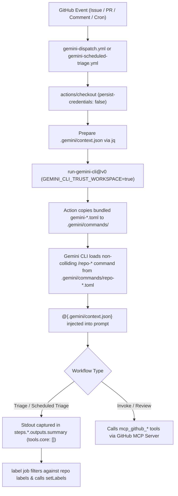

# Fix Gemini CLI GitHub Actions Workflows - Plan

## Goal Capsule

- **Objective:** Restore reliable automated issue triage, scheduled issue triage, pull request review, and on-demand `@gemini-cli` invocation in GitHub Actions with `google-github-actions/run-gemini-cli@v0`.
- **Authority hierarchy:** Product Contract requirements (`R1`–`R7`) govern workflow behavior; Planning Contract decisions (`KTD1`–`KTD5`) govern implementation mechanism; implementation units (`U1`–`U4`) sequence file-level changes.
- **Execution profile:** Repository configuration and GitHub Actions workflow changes (`execution: code`), verified locally via YAML/TOML/JSON validation and remotely via GitHub Actions workflow runs.
- **Stop conditions:** Stop and surface a blocker if `GEMINI_API_KEY` is missing or revoked on the repository, or if a workflow change requires new repository secrets or Google Cloud infrastructure.
- **Tail ownership:** Atomic commits on the active worktree branch, followed by pull request verification using isolated per-command `gh` authentication.

---

## Product Contract

### Summary

Update the repository's Gemini CLI GitHub Actions workflows and custom command prompts so issue triage, scheduled triage, pull request review, and interactive invocation execute in a trusted workspace, load repository-owned command definitions without being overwritten by action defaults, pass untrusted issue and PR content via structured JSON context files rather than shell interpolation, and apply issue labels from the CLI's structured output.

### Problem Frame

GitHub Actions runs for `🔀 Gemini Dispatch` and `🔀 Gemini Triage` on `onel0p3z/image-annotator` failed on external issues (`#5` and `#6`), leaving open issues unlabeled and posting failure comments back to issue authors. Investigation across the repository's `.github/` workflows and upstream `google-github-actions/run-gemini-cli@v0` (`v0.1.22` and post-release fixes) identified five compounding defects:

1. **Untrusted workspace abort in headless mode:** Starting in `@google/gemini-cli@0.39.1`, headless runs exit with code 1 and non-JSON stderr (`Gemini CLI is not running in a trusted directory`) unless `GEMINI_CLI_TRUST_WORKSPACE: 'true'` is set in the step environment.
2. **Wrong command directory and action overwrite collision:** The repository stores TOML prompts under `.github/commands/`, whereas `gemini-cli` reads `.gemini/commands/`. Furthermore, `run-gemini-cli@v0` runs `cp -r "${GITHUB_ACTION_PATH}/.github/commands/"* .gemini/commands/` before invoking `gemini`, overwriting any `.gemini/commands/gemini-*.toml` file with stale `v0` templates.
3. **Unsafe shell interpolation and fragile `$GITHUB_ENV` output in `v0` templates:** The stale `v0` prompts use `!{echo $VAR}` shell expansion (tracked upstream as `GHSA-62f2-6rx8-v262`) and require the model to run `echo "SELECTED_LABELS=..." >> "$GITHUB_ENV"` via a shell tool call.
4. **Contradictory scheduled triage search query:** `.github/workflows/gemini-scheduled-triage.yml` searches for `no:label label:"status/needs-triage"`, which matches zero issues because an issue cannot simultaneously have no labels and have a label.
5. **MCP tool policy exclusion in `gemini-cli v0.41.0+`:** Setting `tools.core` in `gemini-invoke.yml` and `gemini-review.yml` without including `mcp_github_*` causes the Gemini CLI policy engine to exclude all GitHub MCP server tools from the tool registry.

### Requirements

**Workspace Trust and Command Resolution**

- R1. Every `google-github-actions/run-gemini-cli@v0` step across `.github/workflows/gemini-triage.yml`, `.github/workflows/gemini-scheduled-triage.yml`, `.github/workflows/gemini-invoke.yml`, and `.github/workflows/gemini-review.yml` must check out the repository with `persist-credentials: 'false'` and set `GEMINI_CLI_TRUST_WORKSPACE: 'true'` so headless `gemini-cli` runs succeed.
- R2. Custom slash-command TOML files must reside in `.gemini/commands/` under filenames that do not collide with `run-gemini-cli@v0`'s bundled `gemini-*.toml` filenames, and the obsolete `.github/commands/` copies must be removed.

**Safe Context Passing and Triage Output Wiring**

- R3. Issue triage, scheduled triage, review, and invoke workflows must serialize untrusted event inputs into `.gemini/context.json` using `jq -n --arg ...` before running `run-gemini-cli@v0`, and the corresponding `.gemini/commands/*.toml` prompts must read that file via `@{.gemini/context.json}` instead of `!{echo ...}` shell interpolation.
- R4. Single-issue triage (`.github/workflows/gemini-triage.yml`) and scheduled triage (`.github/workflows/gemini-scheduled-triage.yml`) must capture label selections from the action's `summary` output (`steps.<id>.outputs.summary`) with `"tools": { "core": [] }` and validate selected labels against the repository's existing labels before applying them.
- R5. Scheduled triage (`.github/workflows/gemini-scheduled-triage.yml`) must query open issues with `no:label OR label:"status/needs-triage"` and pass the matched issue numbers to `github_issue_number`.

**MCP Tooling and CLI Isolation**

- R6. Interactive invocation (`.github/workflows/gemini-invoke.yml`) and pull request review (`.github/workflows/gemini-review.yml`) must allowlist `mcp_github_*` in `tools.core` and reference the registered `mcp_github_*` tool names in their prompts so GitHub MCP tools remain callable on `@google/gemini-cli@0.41.0+`.
- R7. All GitHub CLI operations executed during verification or repository inspection must authenticate per command for `onel0p3z` without mutating the machine's active `gh` account.

### Scope Boundaries

**In Scope**

- `.github/workflows/gemini-dispatch.yml`, `.github/workflows/gemini-triage.yml`, `.github/workflows/gemini-scheduled-triage.yml`, `.github/workflows/gemini-invoke.yml`, and `.github/workflows/gemini-review.yml`.
- Migrating `.github/commands/*.toml` to non-colliding `.gemini/commands/*.toml` command definitions.

**Out of Scope**

- React web application and VS Code extension source code (`App.tsx`, `components/`, `vscode-extension/`).
- Provisioning Google Cloud Vertex AI, Workload Identity Federation, or GitHub App installations (workflows must operate using the existing `GEMINI_API_KEY` secret and default `GITHUB_TOKEN`).

#### Deferred to Follow-Up Work

- Adding an automated `@gemini-cli /approve` plan-execution workflow (`gemini-plan-execute.yml`) if maintainer-approved autonomous PR creation is desired later.

---

## Planning Contract

### Key Technical Decisions

- KTD1. **Per-invocation `gh` authentication via `GH_TOKEN=$(gh auth token --user onel0p3z)`** (session-settled: user-directed — chosen over `gh auth switch`: avoids interfering with concurrent sessions or agents sharing the host `gh` CLI configuration). Every `gh` CLI command in verification and PR workflows passes the `onel0p3z` token via environment variable rather than changing global auth state. Cites R7.
- KTD2. **Non-colliding command filenames in `.gemini/commands/`** (`repo-triage.toml`, `repo-scheduled-triage.toml`, `repo-invoke.toml`, `repo-review.toml`). `run-gemini-cli@v0` executes `cp -r "${GITHUB_ACTION_PATH}/.github/commands/"* .gemini/commands/` on every run, which overwrites `gemini-triage.toml`, `gemini-scheduled-triage.toml`, `gemini-invoke.toml`, and `gemini-review.toml` with the action's unpatched `v0.1.22` files. Naming the repository's commands `/repo-triage`, `/repo-scheduled-triage`, `/repo-invoke`, and `/repo-review` ensures `gemini-cli` loads the checked-out repository prompts untouched. Cites R1, R2.
- KTD3. **Structured JSON context files (`@{.gemini/context.json}`) and `outputs.summary` for triage**. Each workflow writes event fields to `.gemini/context.json` via `jq -n --arg`, and the TOML prompts inject the file via `@{.gemini/context.json}`. Triage prompts return only the CSV label list (single issue) or JSON array (scheduled triage) on stdout so downstream `label` jobs read `steps.<id>.outputs.summary` directly and sanitize optional markdown code fences before parsing, allowing `"tools": { "core": [] }` with zero shell tool access on untrusted issue content. Cites R3, R4.
- KTD4. **Keep self-contained `/repo-review` prompt with `mcp_github_*` allowlisting instead of `gemini-cli-extensions/code-review`**. Upstream `run-gemini-cli` `examples/workflows/pr-review` switched to `extensions: ["https://github.com/gemini-cli-extensions/code-review"]` with `"tools": { "core": [] }`, which currently fails in `run-gemini-cli@v0` due to two upstream bugs: `echo "Y" | gemini extensions install` aborts on the second consent prompt (`run-gemini-cli#533`), and `"core": []` blocks `mcp_github_*` tools in `gemini-cli >= 0.41.0` (`run-gemini-cli#532`). Retaining the repository's TOML review prompt updated with `mcp_github_*` tool names and `"mcp_github_*"` in `tools.core` avoids both failure modes. Cites R6.
- KTD5. **Standardize `GEMINI_DEBUG` variable lookup with fallback to `DEBUG`**. Upstream workflows check `vars.GEMINI_DEBUG || vars.ACTIONS_STEP_DEBUG || false`, whereas existing workflows in this repo check `vars.DEBUG`. Supporting `vars.GEMINI_DEBUG || vars.DEBUG || vars.ACTIONS_STEP_DEBUG || false` preserves backward compatibility while matching upstream conventions. Cites R1.

### High-Level Technical Design



### System-Wide Impact

- **Security posture on untrusted inputs:** Issue triage and scheduled triage run on public issue titles and bodies with `GITHUB_TOKEN: ''`, `persist-credentials: 'false'`, `"tools": { "core": [] }`, and `jq`-encoded `.gemini/context.json`. No shell command execution or token exposure occurs while analyzing untrusted issue text.
- **GitHub Actions concurrency and permissions:** Workflow permissions remain least-privilege (`contents: read`, `issues: read` in the analysis job; `issues: write` isolated to the downstream `label` job).
- **Repository layout:** `.github/commands/` is replaced by `.gemini/commands/`, which is also the standard location recognized by local `gemini-cli` runs.

### Risks & Dependencies

- **Model formatting variance in `outputs.summary`:** Even when instructed to output only CSV labels or raw JSON, models occasionally wrap output in markdown code fences (` ```json ... ``` `). Mitigation: Strip optional markdown code fences and surrounding whitespace in the `Apply labels` script of both `gemini-triage.yml` and `gemini-scheduled-triage.yml` before parsing CSV or `JSON.parse`.
- **Docker image availability on `ubuntu-latest` for `invoke` and `review`:** `gemini-invoke.yml` and `gemini-review.yml` pull `ghcr.io/github/github-mcp-server`. Mitigation: Keep the configured MCP server container and ensure `mcp_github_*` is allowlisted in `tools.core`.

### Sources & Research

- Local workflows: `.github/workflows/gemini-dispatch.yml`, `.github/workflows/gemini-triage.yml`, `.github/workflows/gemini-scheduled-triage.yml`, `.github/workflows/gemini-invoke.yml`, `.github/workflows/gemini-review.yml`.
- Local command definitions: `.github/commands/gemini-triage.toml`, `.github/commands/gemini-scheduled-triage.toml`, `.github/commands/gemini-invoke.toml`, `.github/commands/gemini-review.toml`.
- Upstream `google-github-actions/run-gemini-cli` references:
  - `action.yml` (`Install Custom Commands` overwrite behavior and `gemini_response` -> `outputs.summary` mapping).
  - Issue `#503` / PR `#507` (`GEMINI_CLI_TRUST_WORKSPACE: 'true'` requirement for `@google/gemini-cli@0.39.1+`).
  - Issue `#499` / PR `#500` (`no:label OR label:"status/needs-triage"` search query fix).
  - Issue `#509` / PR `#511` / Issue `#523` / `GHSA-62f2-6rx8-v262` (migration from `!{echo $VAR}` to `@{.gemini/context.json}`).
  - Issue `#510` / PR `#515` / Issue `#532` / Issue `#533` (`mcp_github_*` tool registration names, `tools.core` policy exclusion in `gemini-cli v0.41.0+`, and extension consent hang).

---

## Implementation Units

### U1. Migrate and Harden Custom Slash-Command Prompts in `.gemini/commands/`

- **Goal:** Replace the unreferenced, shell-interpolated `.github/commands/gemini-*.toml` files with safe, non-colliding `.gemini/commands/repo-*.toml` prompts that use `@{.gemini/context.json}` file injection.
- **Requirements:** R2, R3, R4, R6
- **Dependencies:** None
- **Files:**
  - Create: `.gemini/commands/repo-triage.toml`
  - Create: `.gemini/commands/repo-scheduled-triage.toml`
  - Create: `.gemini/commands/repo-invoke.toml`
  - Create: `.gemini/commands/repo-review.toml`
  - Delete: `.github/commands/gemini-triage.toml`
  - Delete: `.github/commands/gemini-scheduled-triage.toml`
  - Delete: `.github/commands/gemini-invoke.toml`
  - Delete: `.github/commands/gemini-review.toml`
- **Approach:**
  1. Create `.gemini/commands/repo-triage.toml` per KTD2 and KTD3: read `available_labels`, `issue_title`, and `issue_body` from `@{.gemini/context.json}` and instruct the model to output only the comma-separated list of matching labels (or an empty string) with no shell command execution.
  2. Create `.gemini/commands/repo-scheduled-triage.toml` per KTD2 and KTD3: read `available_labels` and `issues_to_triage` from `@{.gemini/context.json}` and instruct the model to output only the raw JSON array of `{issue_number, labels_to_set, explanation}` objects on stdout.
  3. Create `.gemini/commands/repo-invoke.toml` and `.gemini/commands/repo-review.toml` per KTD2, KTD3, and KTD4: read event metadata from `@{.gemini/context.json}` and update tool references to the `mcp_github_*` naming convention.
  4. Remove the four legacy `.github/commands/gemini-*.toml` files so no `!{echo ...}` templates remain in the repository.
- **Execution note:** This unit modifies TOML prompt definitions; verify TOML syntax validity via a Python `tomllib` parse check before committing.
- **Patterns to follow:** Upstream `google-github-actions/run-gemini-cli` `examples/workflows/issue-triage/*.toml` for `@{.gemini/context.json}` input blocks and strict stdout output specifications.
- **Test scenarios:**
  - **Happy path — TOML syntax and required keys:** Parsing all four `.gemini/commands/repo-*.toml` files with Python `tomllib` succeeds and each file defines non-empty `description` and `prompt` string keys.
  - **Edge case — Zero shell interpolation directives:** Scanning `.gemini/commands/*.toml` confirms zero occurrences of `!{` and confirms `@{.gemini/context.json}` is present in every file.
  - **Integration — Non-collision with `run-gemini-cli@v0` bundled commands:** None of the filenames in `.gemini/commands/` match `gemini-{triage,scheduled-triage,invoke,review,issue-fixer,plan-execute}.toml`.
- **Verification:** All four `.gemini/commands/repo-*.toml` files parse cleanly as valid TOML, `.github/commands/` is removed, and no `!{` directives exist in the repository.

### U2. Fix Single-Issue Triage Workflow (`.github/workflows/gemini-triage.yml`)

- **Goal:** Update `.github/workflows/gemini-triage.yml` to check out the repository, write `.gemini/context.json`, trust the workspace, invoke `/repo-triage` with `tools.core: []`, and wire `steps.gemini_analysis.outputs.summary` to the `label` job.
- **Requirements:** R1, R2, R3, R4
- **Dependencies:** U1
- **Files:**
  - Modify: `.github/workflows/gemini-triage.yml`
- **Approach:**
  1. Change `jobs.triage.outputs.selected_labels` from `'${{ env.SELECTED_LABELS }}'` to `'${{ steps.gemini_analysis.outputs.summary }}'` per KTD3.
  2. Add a `Checkout repository` step (`actions/checkout@08c6903cd8c0fde910a37f88322edcfb5dd907a8` with `persist-credentials: 'false'`) matching `.github/workflows/gemini-review.yml` per R1.
  3. Add a `Prepare prompt context` step that creates `.gemini/context.json` using `jq -n --arg labels --arg title --arg body --arg additional_context` before `Run Gemini issue analysis` per R3.
  4. In `Run Gemini issue analysis`, set `GEMINI_CLI_TRUST_WORKSPACE: 'true'` in `env:`, remove raw `ISSUE_TITLE`/`ISSUE_BODY`/`AVAILABLE_LABELS` env vars from the CLI step, add `github_issue_number: '${{ github.event.issue.number }}'`, set `"tools": { "core": [] }` in `settings`, update `gemini_debug` per KTD5, and set `prompt: '/repo-triage'` per KTD2.
  5. Harden the `Apply labels` script in the `label` job to strip any markdown code fences or newlines from `process.env.SELECTED_LABELS` before splitting by comma and filtering against `availableLabels`.
- **Patterns to follow:** `.github/workflows/gemini-review.yml` for SHA-pinned `actions/checkout`; upstream `examples/workflows/issue-triage/gemini-triage.yml` for context preparation and output wiring.
- **Test scenarios:**
  - **Happy path — Workflow YAML and embedded JSON settings validity:** Parsing `.github/workflows/gemini-triage.yml` with YAML parser and parsing `jobs.triage.steps[gemini_analysis].with.settings` with `json.loads` both succeed.
  - **Edge case — Issue body with URLs, quotes, and `&` characters:** `jq -n --arg` serializes `ISSUE_TITLE` and `ISSUE_BODY` (such as Issue `#6`'s URL query strings) into valid `.gemini/context.json` without shell word-splitting or glob expansion.
  - **Edge case — Model wraps CSV labels in markdown fences or whitespace:** The `Apply labels` script strips code fences and whitespace before matching against `availableLabels`, applying only valid repository labels.
- **Verification:** `.github/workflows/gemini-triage.yml` validates as legal GitHub Actions YAML with valid embedded JSON `settings`, references `/repo-triage`, sets `GEMINI_CLI_TRUST_WORKSPACE: 'true'`, and wires `selected_labels` from `steps.gemini_analysis.outputs.summary`.

### U3. Fix Scheduled Issue Triage Workflow (`.github/workflows/gemini-scheduled-triage.yml`)

- **Goal:** Fix the contradictory issue search query in `.github/workflows/gemini-scheduled-triage.yml` and align checkout, `.gemini/context.json` preparation, workspace trust, `/repo-scheduled-triage` prompt invocation, and `outputs.summary` parsing.
- **Requirements:** R1, R2, R3, R4, R5, R7
- **Dependencies:** U1
- **Files:**
  - Modify: `.github/workflows/gemini-scheduled-triage.yml`
- **Approach:**
  1. Change `jobs.triage.outputs.triaged_issues` from `'${{ env.TRIAGED_ISSUES }}'` to `'${{ steps.gemini_issue_analysis.outputs.summary }}'` per KTD3.
  2. Add the SHA-pinned `actions/checkout` step with `persist-credentials: 'false'` per R1.
  3. In `Find untriaged issues`, change `--search 'no:label label:"status/needs-triage"'` to `--search 'no:label OR label:"status/needs-triage"'` and write `issue_numbers` (comma-separated list of matched issue numbers) to `$GITHUB_OUTPUT` per R5.
  4. Add a `Prepare prompt context` step gated on `steps.find_issues.outputs.issues_to_triage != '[]'` that writes `{available_labels, issues_to_triage}` to `.gemini/context.json` via `jq -n --arg labels --arg issues` per R3.
  5. In `Run Gemini Issue Analysis`, set `GEMINI_CLI_TRUST_WORKSPACE: 'true'`, pass `github_issue_number: '${{ steps.find_issues.outputs.issue_numbers }}'`, set `"tools": { "core": [] }`, update `gemini_debug` per KTD5, and set `prompt: '/repo-scheduled-triage'` per KTD2.
  6. In the `label` job's `Apply labels` script, strip optional markdown code fences (` ```json ... ``` `) from `process.env.TRIAGED_ISSUES` before calling `JSON.parse`, and guard against non-array payloads.
- **Patterns to follow:** Upstream `examples/workflows/issue-triage/gemini-scheduled-triage.yml` and `.github/workflows/gemini-triage.yml` from U2.
- **Test scenarios:**
  - **Happy path — Search query matches unlabeled issues:** Running `gh issue list --state open --search 'no:label OR label:"status/needs-triage"' --json number,title,body` against `onel0p3z/image-annotator` returns the open unlabeled issues (`#2`, `#3`, `#5`, `#6`) rather than `[]`.
  - **Edge case — Markdown-fenced JSON summary:** When `TRIAGED_ISSUES` contains a JSON array wrapped in ` ```json ... ``` `, the `Apply labels` script strips the fence, parses the array, filters labels against `availableLabels`, and applies valid labels.
  - **Error path — Empty or malformed JSON response:** When `TRIAGED_ISSUES` is not valid JSON or parses to a non-array, the script logs a warning rather than throwing an unhandled exception before label application.
- **Verification:** `.github/workflows/gemini-scheduled-triage.yml` validates as YAML/JSON, uses the `OR` search query (verified via isolated `gh` authentication per KTD1), prepares `.gemini/context.json`, invokes `/repo-scheduled-triage`, and parses `steps.gemini_issue_analysis.outputs.summary` safely.

### U4. Align Dispatch, Invoke, and Review Workflows (`.github/workflows/gemini-{dispatch,invoke,review}.yml`)

- **Goal:** Update `gemini-invoke.yml`, `gemini-review.yml`, and `gemini-dispatch.yml` to use `GEMINI_CLI_TRUST_WORKSPACE: 'true'`, `actions/checkout` with `persist-credentials: 'false'`, `.gemini/context.json`, `/repo-invoke` and `/repo-review`, and `mcp_github_*` tool allowlisting.
- **Requirements:** R1, R2, R3, R6
- **Dependencies:** U1
- **Files:**
  - Modify: `.github/workflows/gemini-invoke.yml`
  - Modify: `.github/workflows/gemini-review.yml`
  - Modify: `.github/workflows/gemini-dispatch.yml`
- **Approach:**
  1. In `.github/workflows/gemini-invoke.yml`, add the SHA-pinned `actions/checkout` step (`persist-credentials: 'false'`), add the `Prepare prompt context` step writing `{title, description, event_name, is_pull_request, issue_number, repository, additional_context}` to `.gemini/context.json`, set `GEMINI_CLI_TRUST_WORKSPACE: 'true'`, pass `github_pr_number` and `github_issue_number`, include `"mcp_github_*"` in `tools.core` alongside the read-only shell commands, update `gemini_debug` per KTD5, and set `prompt: '/repo-invoke'`.
  2. In `.github/workflows/gemini-review.yml`, add `persist-credentials: 'false'` to the existing `actions/checkout` step, add the `Prepare prompt context` step writing `{repository, pull_request_number, additional_context}` to `.gemini/context.json`, set `GEMINI_CLI_TRUST_WORKSPACE: 'true'`, pass `github_pr_number`, include `"mcp_github_*"` in `tools.core`, update `gemini_debug` per KTD5, and set `prompt: '/repo-review'`.
  3. In `.github/workflows/gemini-dispatch.yml`, update the `debugger` job condition to support `vars.GEMINI_DEBUG || vars.DEBUG || vars.ACTIONS_STEP_DEBUG || false` per KTD5.
- **Patterns to follow:** `.github/workflows/gemini-review.yml` checkout pin (`actions/checkout@08c6903cd8c0fde910a37f88322edcfb5dd907a8`) and `.github/workflows/gemini-triage.yml` context-preparation step.
- **Test scenarios:**
  - **Happy path — Workflow YAML and settings JSON validation:** All five `.github/workflows/gemini-*.yml` files parse cleanly as YAML, and all embedded `settings` strings parse as valid JSON.
  - **Integration — MCP tool allowlist compatibility:** Both `gemini-invoke.yml` and `gemini-review.yml` include `"mcp_github_*"` in `settings.tools.core` so `@google/gemini-cli@0.41.0+` does not exclude the `github` MCP server tools.
  - **Integration — Dispatch routing:** `gemini-dispatch.yml` routes `issues.opened`/`issues.reopened` and `@gemini-cli /triage` to `gemini-triage.yml`, `pull_request.opened` and `@gemini-cli /review` to `gemini-review.yml`, and `@gemini-cli` comments to `gemini-invoke.yml`.
- **Verification:** All workflow files validate without syntax or schema errors, every `run-gemini-cli@v0` call sets `GEMINI_CLI_TRUST_WORKSPACE: 'true'` and invokes its corresponding `/repo-*` command after checking out the repository and writing `.gemini/context.json`.

---

## Verification Contract

| Gate | Command / Check | Applies to | Pass Criterion |
|---|---|---|---|
| TOML syntax & prompt audit | `python3 -c "import glob, tomllib; files=glob.glob('.gemini/commands/*.toml'); assert len(files)==4; [tomllib.load(open(f,'rb')) for f in files]"` | U1 | Exits 0; 4 TOML files parse; zero `!{` occurrences |
| Workflow YAML & embedded JSON validation | `python3` validation script parsing all `.github/workflows/*.yml` and `json.loads` on every `with.settings` block | U2, U3, U4 | Exits 0; all workflow YAML and JSON settings blocks are valid |
| Scheduled triage search query check | `GH_TOKEN=$(gh auth token --user onel0p3z) gh issue list --repo onel0p3z/image-annotator --state open --search 'no:label OR label:"status/needs-triage"' --json number` | U3 | Returns open unlabeled issues (`#2`, `#3`, `#5`, `#6`) while active `gh` account remains unchanged |
| Remote workflow verification | Trigger `gemini-scheduled-triage.yml` or issue triage on GitHub via `GH_TOKEN=$(gh auth token --user onel0p3z) gh ...` after pushing | U1–U4 | Workflow completes with `conclusion: success` and applies appropriate labels |

---

## Definition of Done

- All four custom command files exist under `.gemini/commands/repo-*.toml`, parse as valid TOML, use `@{.gemini/context.json}`, and `.github/commands/` is deleted.
- `.github/workflows/gemini-triage.yml`, `.github/workflows/gemini-scheduled-triage.yml`, `.github/workflows/gemini-invoke.yml`, `.github/workflows/gemini-review.yml`, and `.github/workflows/gemini-dispatch.yml` pass YAML and embedded JSON validation.
- Every `run-gemini-cli@v0` step runs after `actions/checkout` (`persist-credentials: 'false'`) and `Prepare prompt context`, sets `GEMINI_CLI_TRUST_WORKSPACE: 'true'`, and references `/repo-*`.
- No temporary or experimental files remain in the working tree (`git status` clean after atomic commits).
- Global `gh auth status` active account remains unchanged throughout all verification commands.
